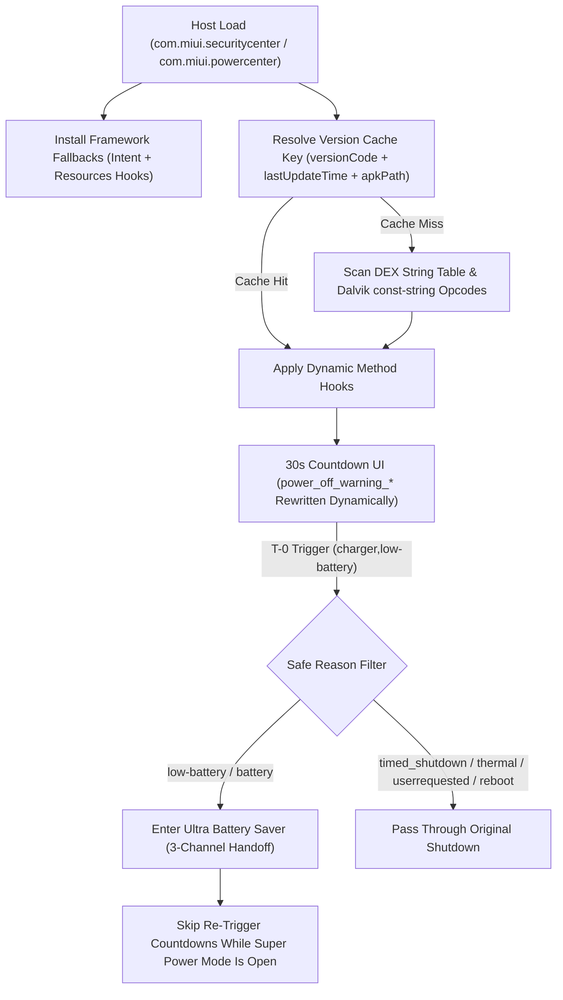

# Cryostasis

[English](README.md) | [简体中文](README_zh.md)

**Cryostasis** defies terminal low-battery shutdown on Xiaomi HyperOS and MIUI. Instead of powering off the phone when the 30-second critical battery countdown expires, Cryostasis intercepts the shutdown trigger at T-0 and transitions the system into **Ultra Battery Saver (超级省电模式)**—preserving session continuity and emergency connectivity until you reach a charger.

Unlike brittle Xposed patches tied to a single APK build, Cryostasis embeds a **zero-hardcode runtime DEX bytecode anchor engine**. Across any version of Xiaomi SecurityCenter (`com.miui.securitycenter` / `com.miui.powercenter`), ProGuard/R8 obfuscated classes and methods (`z7.x.T`, `z7.x.R`, `I7.B.Q0`, etc.) are resolved dynamically from invariant string anchors on cold start and cached per host package version.

---

## Architecture



### Four-Layer Resilience

| Layer | Mechanism | Responsibility |
|---|---|---|
| **1. Runtime DEX Anchor Locator** | Parses `classes*.dex` headers (`string_ids`, `type_ids`, `proto_ids`, `field_ids`, `method_ids`, `class_defs`) & Dalvik `0x1A` / `0x1B` opcodes | Resolves trigger (`charger,low-battery`), countdown (`Already displayed power off countdown`), `REQUEST_SHUTDOWN` helpers, `SuperPowerSaveManager.switchSuperPower`, and `changeSuperPowerMode` static helpers without hardcoded class names |
| **2. Owner-User & Anti-Loop Guards** | Restricts shutdown interception to Owner User (`user 0`), guards non-owner `PowerSaverProvider`/`switchSuperPower` entry, checks `power_supersave_mode_open` + `enter_local` + cooldown | Prevents non-owner / work profiles (e.g., User 10) from entering Super Power Save concurrently and corrupting shared `force_fsg_nav_bar`, animation scales, or `UiModeManagerService.mNightMode` |
| **3. Framework Intent Fallback** | Hooks `ContextWrapper` & `ContextImpl` (`startActivity`, `sendBroadcast`) | Catches explicit low-battery `REQUEST_SHUTDOWN` / `ACTION_REQUEST_SHUTDOWN` intents while ignoring `null`-reason scheduled shutdowns on MIUI 12.2 – HyperOS 1.0 |
| **4. 3-Channel Handoff & Dynamic Localization** | `PowerSaverProvider` (`content://com.miui.powercenter.powersaver`) → dynamic helper → `Settings.System` + `Resources.getIdentifier` | Activates Ultra Battery Saver reliably and dynamically rewrites dialog/notification warning strings (ZH & EN) without hardcoded `R.string` hex IDs |

### Safety Guarantees

Cryostasis inspects `android.intent.extra.REASON` and utility call arguments before intercepting. Scheduled shutdowns (`timed_shutdown`), thermal protections (`temp` / `thermal`), manual shutdowns (`userrequested`), `reboot`, and `recovery` always pass through untouched. Note that hardware-level emergency cutoff at true 0% cell voltage (`BatteryService`) operates below userspace and remains unaffected.

---

## Requirements & Usage

1. Rooted Xiaomi / Redmi / POCO device running MIUI or HyperOS with **LSPosed** installed
2. Install `Cryostasis.apk` (from [Releases](https://github.com/AotianNeo/Cryostasis/releases) or built from source)
3. Enable **Cryostasis** in LSPosed Manager
4. Ensure scope includes **SecurityCenter / 手机管家** (`com.miui.securitycenter`, auto-declared via `xposedscope`)
5. Force-stop SecurityCenter or reboot once

Verified on Xiaomi Android 16 / HyperOS (`SecurityCenter 12.8.3`): runtime DEX resolution, dynamically localized 30-second countdown notification (`电量过低，即将进入超级省电`), T-0 interception into `PowerSaverProvider`, `power_supersave_mode_open=1` activation, and anti-loop countdown suppression on subsequent triggers all pass end-to-end.

---

## Build from Source

Cryostasis builds cleanly with standard JDK + Android SDK build-tools—no heavy Gradle daemon required (standard Gradle configuration is also included for Android Studio).

### Prerequisites
- JDK 11+ (`javac`, `keytool`)
- Android SDK (`platforms/android-35` or newer + `build-tools`)
- Python 3 (stdlib only)

```bash
git clone https://github.com/AotianNeo/Cryostasis.git
cd Cryostasis
python3 tools/build_apk.py
```

The output APK is written to `build/Cryostasis.apk` and automatically verified via `apksigner verify --verbose`.

To sign with your own release keystore:

```bash
KEYSTORE_PATH=/path/to/release.jks KEYSTORE_PASS=*** KEY_ALIAS=cryostasis python3 tools/build_apk.py
```

---

## License

[MIT](LICENSE)
